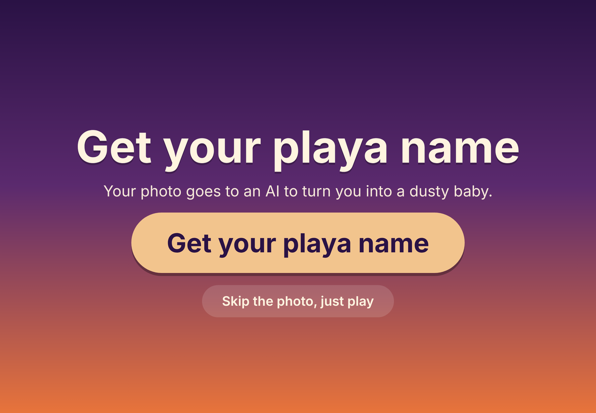
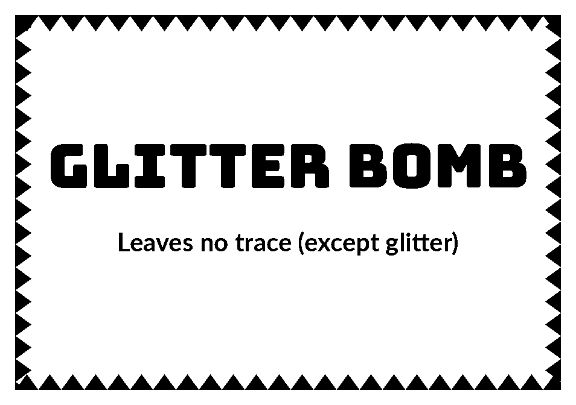

<div align="center">

# Baby Burn Name Generator

### **Walk up a stranger. Walk away with a playa name, a badge, and a dusty-baby portrait.**


*A party kiosk for Baby Burn: a quick quiz on an iPad, a never-repeating playa name printed on a badge, and an AI "dusty baby" photo to scan home.*

[**Demo**](#see-it-in-action) · [**Quick Start**](#quick-start) · [**How It Works**](#how-it-works) · [**Ops guide**](docs/ops.md)

</div>

---

## The Problem Everyone Ignores

A house party of about 200 people, most of whom don't know each other, running until 4am. Name tags are the classic icebreaker and the classic failure: a Sharpie, a sticker, "HELLO my name is," and then nobody reads them.

- **Nobody wants to fill one in.** Typing, spelling, deciding what to write.
- **Nothing to say about it.** "Dave" doesn't start a conversation.
- **Party tech breaks at the worst moment.** A spinner, a Wi-Fi blip, a jammed printer, and the line backs up.

**Sound familiar?** The icebreaker is the thing everyone walks past.

## The Insight That Changed Everything

People don't want to write a name tag. They want to be given one, and the funnier the better.

<div align="center">

### **Make the quiz a comedy bit, not a test,**
### **and make the badge a souvenir worth wearing.**

</div>

Every input is a tap. The questions mix real playa lore with Baby Burn inside jokes. The name comes from a hand-approved list and is never handed out twice, so every badge is a one-of-one that starts its own conversation.

<div align="center">

## **Under 30 seconds from first tap to printed badge.**

</div>

## Introducing the Baby Burn Name Generator

A kiosk app that runs on a Raspberry Pi, drives an iPad and a label printer, and survives a whole night of real use.

| Component | Role |
|:----------|:-----|
| **Kiosk (iPad)** | Start screen, optional photo, a few tap-only quiz questions, the reveal |
| **App (Raspberry Pi, Flask, Python 3.11)** | Sessions, quiz logic, name picking, printing, admin |
| **Badge printer (Brother QL-800)** | Prints the name, a tagline, your first Baby Burn year and a fun border on a DK-1234 name-badge label |
| **AI photo transform (OpenAI or Gemini)** | Turns your photo into a "dusty baby"; the provider is a setting, picked by a bake-off |
| **Photo hosting (Cloudflare R2)** | A QR on screen (and a small one on the badge) opens your photo page; unshared photos are deleted after 14 days |
| **Admin (`/admin`)** | Review every name and question before it goes live, and add new ones on the night |

## See It In Action

<div align="center">

 

*The kiosk start screen, and a badge rendered from the public sample content (`tools/preview_badges.py`). Try the kiosk with no server at all: open `kiosk.html?stub`.*

</div>

## What Makes It Party-Proof

| Feature | What It Does | Why It Matters |
|:--------|:-------------|:---------------|
| **Never-repeating names** | Each approved name is given out at most once, ever, and survives reboots | Every badge is a one-of-one |
| **Owner-approved content only** | Every name, question and tagline has a review status; nothing unapproved reaches a guest | No surprises on a badge at 2am |
| **Tap-only, skippable flow** | No typing anywhere, and every step can be skipped, including the photo | Nobody gets stuck; the line keeps moving |
| **Photo privacy by default** | The start screen says up front that the photo goes to an AI; unshared photos expire after 14 days; the shared album is opt-in | Guests know where their face goes and when it's gone |
| **Private content, public code** | Real names and inside jokes live in a separate private repo; this repo ships a tame `content.sample/` | The code can be open without leaking the party |
| **Printing never waits on the cloud** | If the AI transform takes longer than ~25 s or fails, the reveal falls back to your photo with a local dust filter; if an upload fails, the badge still prints | A Wi-Fi blip never stops a badge |
| **Failure drills** | Stub modes for a failed photo, a slow photo and a printer jam (`?stub=fail`, `?stub=slow`, `&jam`) | Problems get rehearsed, not discovered |
| **Tested** | Over 300 tests (`pytest`) | Changes made the week of the party don't break the night |

## Quick Start

Needs [`uv`](https://docs.astral.sh/uv/) (`brew install uv`).

```
uv run --python 3.11 python -m app.web --dev
```

Open http://127.0.0.1:8000/kiosk.html. Add `?stub` to the URL for a no-server demo.

## How It Works

```
 iPad kiosk ──► Pi (Flask app) ──► Brother QL-800 ──► badge
                    │   ▲
                    │   └── /admin: review and add names, questions, taglines
                    ├──► OpenAI or Gemini: "dusty baby" transform
                    └──► Cloudflare R2: photo page behind a QR code
```

A guest taps Start, optionally takes a photo, answers a few multiple-choice questions, and gets a name from the approved list (answers can lightly influence the pick). The reveal shows the dusty-baby portrait and the name while the badge prints, then a big QR code to grab the photo on your phone, with buttons to share it to the Baby Burn album or delete it. Guests' phones never touch the Pi: the photo page lives in the bucket, so the Pi has no internet-facing server.

## The Story Behind Baby Burn

Baby Burn is a one-night house party in New York, now in its third year. It began as a way to celebrate new mothers who couldn't go to Burning Man, so friends bring the playa home: they build miniature versions of playa experiences, right there in the house.

This kiosk is one of those experiences. On the playa, people get given names; at Baby Burn, a guest walks up to an iPad, snaps a photo, taps through a few absurd questions, sees an AI "dusty baby" version of themselves, and walks away wearing a badge with their new playa name. The point is laughs. The quiz is a comedy bit. The name is a souvenir.

It was built in under two weeks, with hardware, a photo-model bake-off, content review, failure drills, a 30-run soak with friends and a dress rehearsal all scheduled before the party.

<div align="center">

### Everyone gets a name. Nobody gets the same one.

</div>

---

## Start here

1. [docs/ops.md](docs/ops.md) covers setup (Cloudflare, Pi, iPad, printer) and party night.
2. [docs/STATUS.md](docs/STATUS.md): what is done and what is next

## Develop

```
uv run --python 3.11 --extra dev pytest -q
```

The app runs from the checkout, not as an installed package. Settings come
from environment variables (see `.env.example` for every variable). The app
does not read `.env` itself:

- Mac: `uv run --env-file .env ...`
- Pi: the systemd unit's `EnvironmentFile=`

With nothing set it uses the fake transform provider, file printer, and
`content.sample/`.

## Content

`content.sample/` is tame placeholder content (names, questions, taglines).
Real content lives in the PRIVATE repo `bash102/baby-burn-content` (branch
`drafts-v1` until reviewed). Clone it into `content/` (git-ignored) with
`gh repo clone bash102/baby-burn-content content`, then rsync it to the Pi
(see docs/ops.md). `CONTENT_DIR` overrides the location.

## History

- Design spec: `docs/superpowers/specs/`
- Implementation plan: `docs/superpowers/plans/`

---

<div align="center">

**Bring the playa home.**

Throwing your own burn-themed party? Fork it, swap in your own names, and [star the repo](https://github.com/bash102/baby-burn-name-generator) if it made someone laugh.

</div>
